# Evaluation of 2D U-Net vs 2D Convolutional Aggregate Network performance and resource use for the segmentation of HipMRI scans for targeted radiation therapy of the prostate
Data were provided by HipMRI Study for image segmentation - https://arxiv.org/abs/1505.04597

## Overview of the Model
A 2D U-Net and 2D convolutional aggregate network (CAN) have been implemented to aid in the segmentation of the prostate in HipMRI scans for the purpose of targeted radiation therapy. Due to the risks associated with both under- and over-contouring, it is of interest to compare the prostate segmentation accuracy and the resource requirements of both models to determine which is more appropriate for clinical use.

The models can be trained by running train_and_validate(UNet, num_epochs) in train.py, inputting boolean variable 'UNet' to select which model. The model's time, Dice, Intersection Over Union, peak VRAM and number of parameters are reported. A training vs validation loss plot will be saved under "2Dmodel_loss_plot.png", and the optimal model will be saved under "best_2Dmodel.pth" where 'model' is either Unet or CAN.

The models can be tested by running predict(UNet) in predict.py, inputting boolean variable 'UNet' to select which model. All samples in the test set will be evaluated with the optimal model and save the image results in 'model_predictions' as 'model_i.png' where 'model' is either Unet or CAN, and i is the id assigned to the sample. The average Dice and Intersection Over Union values are reported for each channel, and the average evaluation time, peak VRAM.

### 2D U-Net Explanation and Justification of Structure:
The 2D U-Net consists of an encoder and decoder, each with 4 convolution blocks. The convolution block contains 2 3x3 convolutions, the first to alter the number of channels, and the second to refine feature extraction. BatchNorm is used after each convolution since the data is dense and processed in batches of 16. As each sample is normalised, convolutions are performed without bias to prevent creations of redundant variables. ReLU is performed in place after each normalisation to reduce memory consumption. For convolution blocks with high out_channel>512, dropout=0.2 is set to reduce overfitting during training.

Each encoder block is followed by maxPool, reducing the height and width dimensions by 2. As such, each sample is reduced to height and width dimensions (16, 8). The bottleneck performs a final channel expanding convolution block such that each sample has 1024 channels.

The 4 decoder blocks perform a transpose convolution, expanding the sample's height and width by 2, before concatenating the equivalent sample from the encoder leve. This is followed by the convolution block, halving the number of channels. A final 1x1 convolution is performed so that the output has the same number of channels as there are segmentation categories.

**2D U-Net Model Structure:**

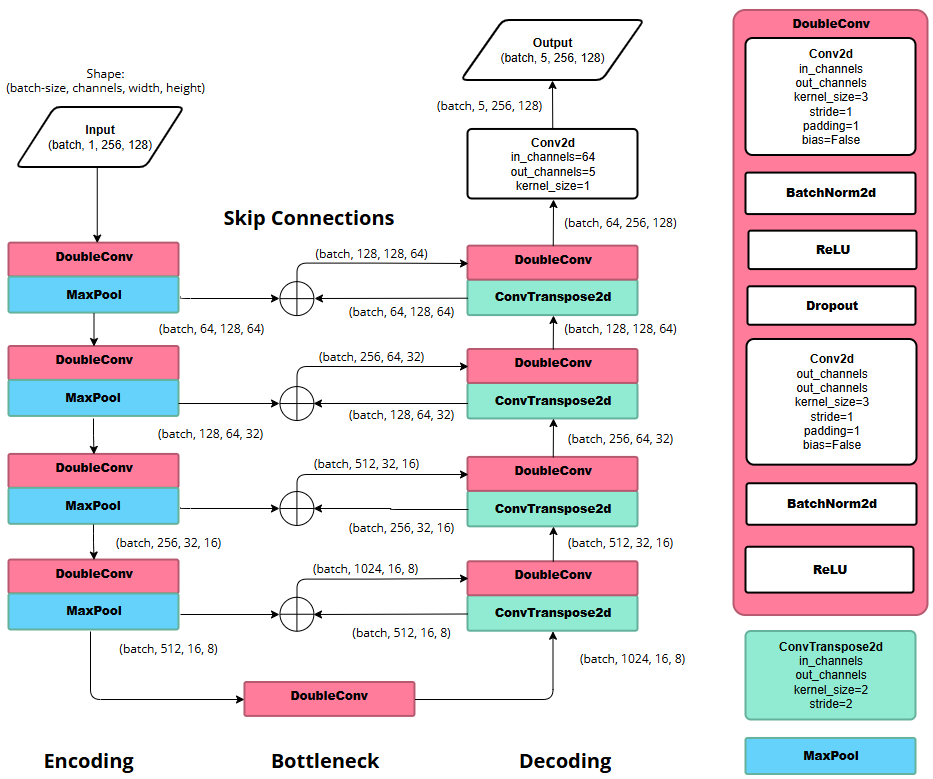

### 2D CAN Explanation and Justification of Structure:
The 2D CAN initially performs two convolution blocks to expand the channel size of all samples in the batch. These blocks are a convolution with kernel_size=3 followed by an instanceNorm to allow for smaller batch sizes if necessary, and then performs a leakyReLU. These convolutions are followed by nine dilated convolution blocks with increasing dilation rates (1, 1, 2, 2, 3, 5, 8, 16, 1). These are similarly constructed to the aforementioned block, however the padding and dilation are defined by the provided dilation variable, to maintain sample dimensions. The initial convolutions, with small dilation factor extract finer details, in the same way as performed in the 2D U-Net. The larger dilations that these are followed by increase the network's field of view, allowing greater context of the image for the model's predictions, while maintaining the sample's dimensions. A final dilation with factor 1 is performed to reintroduce the finer details of the image. Before outputting the results, two convolution blocks are applied, decreasing the channel size to 5, such that each channel contains the model's segmentation predictions.

**2D CAN Model Structure:**

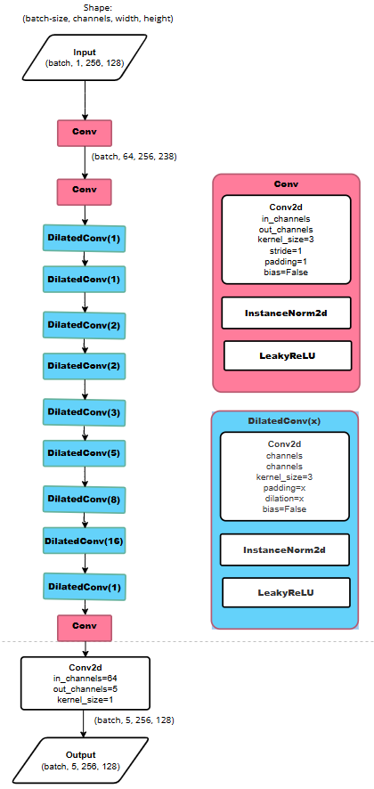

## Dependencies
This repository was trained and evaluated on the Rangpur HPC cluster with the following dependencies:
- python=3.11.15
- numpy=2.4.6
- nibabel=5.4.2
- tqdm=4.70.1 
- torch=2.7.1+cu118
- torchvision=0.22.1+cu118 
- matplotlib=3.11.1 

The results discussed in this report were produced without setting seed. If desired, the seeds for python, numpy and torch can be set for reproducible results.

## Data Preprocessing
To prevent data-leakage, all MRI slices belonging to the same patient are strictly assigned to the same data split, as misleading results would be produced if the same anatomy were present across sets. Specifically, training was performed on slices from patients 4 to 35, validation on patients 36 to 39, and testing on patients 40-42.

All MRI image data was normalised upon loading as specified in the project guidelines, and converted to dimensions [N, H, W]. Similarly, ground truth segmentation masks were converted to [N, H, W, C]. Note, a subset of the data was loaded with height and width (256, 144) where majority were (256, 128). The larger dimensions were cropped equally at the left and right sides, such that all images were (256, 128) which is most suitable for the network operations.

In the construction of PyTorch DataLoaders for this data, the training DataLoader set drop_last=True where the validation and testing loaders didn't to ensure consistent batch sizes for stable normalisation and to avoid overweighting of samples in a smaller batch size. Additionally, the training dataset was assigned a custom TorchVision transformation that included random vertical flipping, slight rotation, and slight scaling with RandomAffine, to reduce overfitting of the data, by training on plausible anatomical variations.

## Training And Validation Process Justification and Results
Training and Validation is executed with train_and_validate() from train.py, with model type specified by UNet boolean variable. Training is performed with the Adam optimised with weight decay=0.0001 and a ReduceLROnPlateau scheduler with patience=4 and factor=0.1, to reduce overfitting. The loss used for optimisation is a combination of Binary Cross Entropy, weighted at 0.3, and the average per channel dice loss, calculated using the model's probability output. Conversely, validation determines the dice loss and Intersection over Union for each channel, using the binary mask corresponding to the highest predicted channels. These are reported for each epoch, where the model is only saved if the prostate channel's validation dice increases.

Upon completion of all epochs, general performance values are reported. These are displayed below. Additionally, each training and validation epoch records their respective prostate channel loss per sample and average combined BCE and dice loss per channel per sample, which are graphed against epochs. These are also presented below, for each model.

|**Training and Validation Performance Results**    | 2D U-Net | 2D CAN |
| -------- | -------- | -------- |
| Total Number of Trainable Parmeters               | 31,036,741 | 406,405  |
| Peak Training/Validation GPU VRAM (GB)            | 3.2254     | 3.5261   |
| Average Training/Validation Epoch Duration (s)    | 47.684     | 49.729s  |
| Saved Model's Validation Prostate Dice            | 0.904217   | 0.906043 |

### Training and Validation Loss and Prostate Segmentation Dice per Epoch
**2D UNet:**
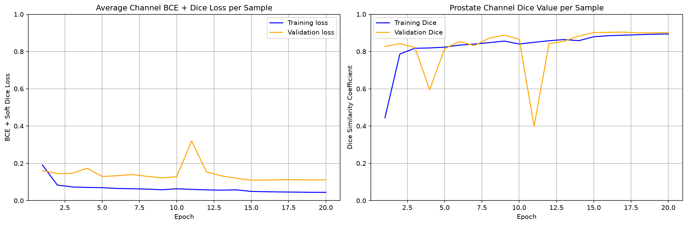

**2D CAN:**
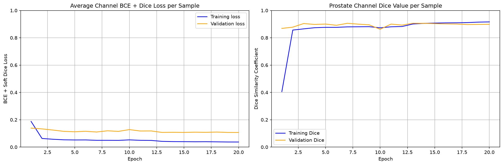

## Testing Results
Testing involves the evaluation of the model's prediction for each sample. These are saved to a directory corresponding to the model used, and each plot the original MRI image, the ground truth segmentation, the model's predicted segmentation and an error map. The error map compares the ground truth and the predicted segmentations for the prostate class, with true positive results in green, false positives in red and false negatives in blue. The dice and IoU values calculated from the error map for the sample, are reported in the image. An example is given below. After the evaluation of all samples, the model's performance is reported, also provided below.

**Example prediction output image:**

Mask Colour Key: *Prostate=Red, Body Outline/Rectum=Black, Bladder=Teal, Bone=Brown, Body=Green*

Error Map Colour Key: *True Positive = Green, False Positive = Red, False Negative = Blue*
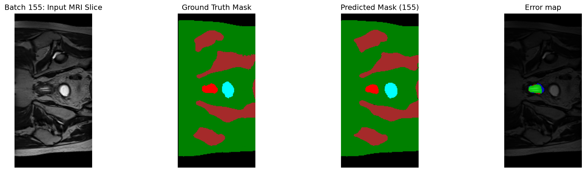

|**Testing Performance Results**           | 2D U-Net | 2D CAN |
| -------- | -------- | -------- |
| Peak Testing GPU VRAM (GB)               | 1.1256     | 0.4079   |
| Average Sample Evaluation Duration (s)   | 0.370087   | 0.367726 |
| Average Testing Dice                     | 0.874180   | 0.878067 |

## Discussion of Results
The performance results outlined above, show comparable prostate channel dice scores during validation and testing, with a slightly larger decrease in the 2D U-Net's performance at testing. Similarly, the training times are comparable, with the U-Net being slightly faster to train and slower to evaluate.

The greatest difference in the models is the number of trainable parameters, which is significantly larger for the U-Net in comparison to the CAN. This likely contributes to the approximately tripled GPU VRAM peak observed during testing. Additionally, observation of the loss plots, suggests the CAN provides stabler training, in comparison to the U-Net. Specifically, the CAN appears to stabilise after epoch 4 with stable and approximately equal Dice scores. The U-Net validation loss stablises after 15 epochs, and has significant variation in prostate channel dice in comparison to the CAN plot.

Upon inspection of the prediction results, transitions between neighbouring slices produced by the CAN are notably smoother compared to the UNet model. Regardless, both models were observed to have the following common failure cases:

### 1. Small prostate false negatives:
Often occurs in the MRI slices where the prostate initially appears or where a new prostate segment appears separate from a pre-existing section, that combine in a later sample. Due to the small area of these segments, both the 2D U-Net and 2D CAN models, will produce false negatives. This is likely due to the similarities with neighbouring samples with almost identical anatomical structure but with no prostate segmentations. Additionally, these small prostate segmentation cases may only be reflected in the initial 2-3 slices from a scan, where the more general prostate segmentation case would have 10-15 slices to train with, and so, the model is less familiar with predicting small prostate segments. Examples of these false negative predictions are given below, where the false negative segmentations are blue in the error map.

**Example false negative prediction of an initial small prostate segmentations:**

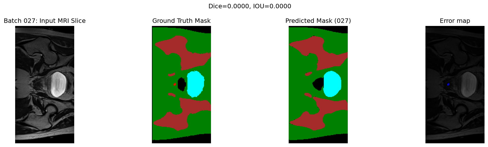

**Example false negative prediction of new small prostate segmentations:**

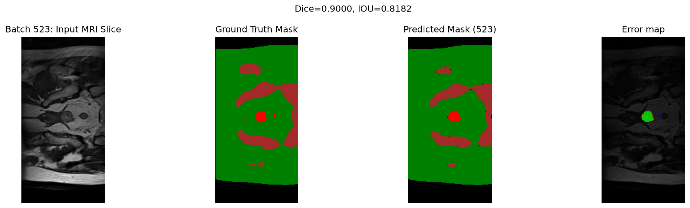

### 2. Small prostate false positives:
Similarly to failure case 1, this will occur in MRI slices where the prostate is expected to initially appear, or new segments usually appear. This occurs in both the 2D U-Net and 2D CAN models, where the model will predict a small new prostate segment that is not present in the sample. This is likely due to the same reasons as described in failure case 1 above. Examples of these false positive predictions are given below, where the false positive segmentations are red in the error map.

**Example false positive prediction of new small prostate segmentations:**

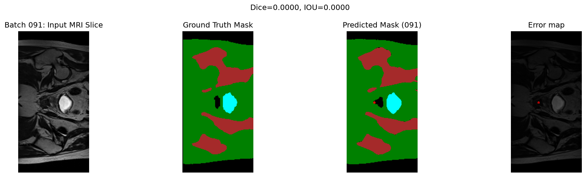

**Example false positive prediction of new small prostate segmentations:**

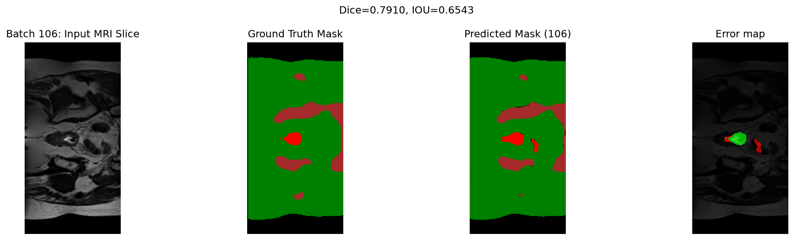

### 3. False negatives at neighbouring rectum segmentations
Both the 2D U-Net and 2D CAN will predict false negatives in slices where the rectum segmentation is vanishing and the prostate segmentation appears. This likely occurs as the prostate and rectum segmentations are often in the same position with similar shape, or are closely neighbouring each other. Hence, both convolution models will associate the same features with both the rectum and prostate segmentations, resulting in the false negatives often observed in the predictions. This most commonly appears as a false negative as the vanishing rectum segmentation is more gradual than the prostate segmentation appearance, and therefore has greater representation in the training set. Therefore the model will predict the rectum segmentation over the prostate, resulting in the false negative predictions that have been observed. Two example cases of this are pictured below.

**Example false negative predictions of rectum segmentations:**

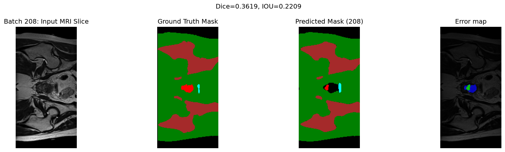

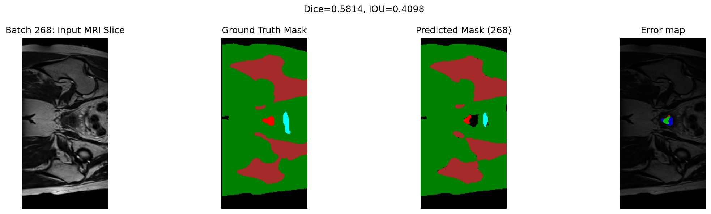

### 4. False positives in the body segment
Due to the similarity in appearance between the prostate and neighbouring anatomy, such as the bowels. Both models, will sometimes produce false positive prostate predictions instead of the correct body segmentation. An example of this is given below.

**Example false positive prostate prediction of the body:**

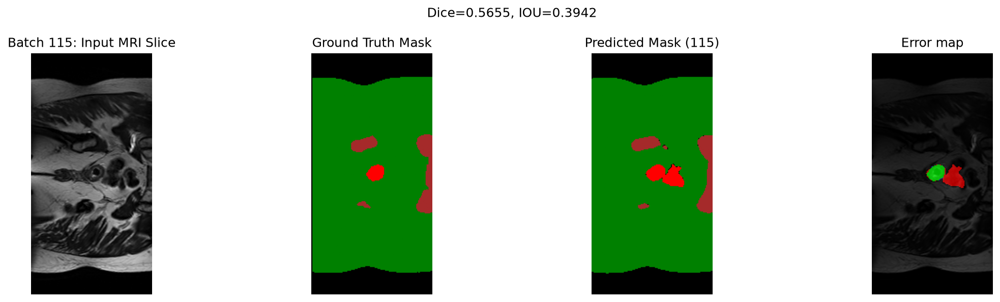

## Verdict
The 2D CAN is recommended over the 2D U-Net for use in segmenting the prostate in HipMRI images. In comparison to the U-Net, the CAN reported approximately equal channel dice during validation and testing. Additionally, both models had equal training time per epoch with the CAN required significantly less epochs, to reach stability. Finally, the VRAM requirements during evaluation are three times lower for the CAN model.

These results suggest the added context introduced by dilations in the CAN, are more suitable for use in MRI segmentation. Additionally, the CAN was observed to produce more continuous neighbouring slice results. 

The 2D CAN does display evidence of common failure cases, especially for the initial MRI slices involving the prostate and differentiating the prostate segmentation from the rectum. It is recommended that 3D U-Net and 3D CAN models, are implemented to determine if these failure cases can be avoided with volumetric context, and whether the increased time and memory resources are worth 

## Artificial Intelligence Usage Disclosure:
Gemini used:
- for understanding Nifti loading functions provided in the task
- in data_preprocess() for locally saving ndarrays produced by load_data_2D() and accessing this saved data in get_dataloaders() - validated by successfull saving and loading
- for crop2D() in dataset.py to resize (256, 144) images to (256, 128) - validated by rewriting generated code and runtime errors stopped after implementation
- in mri_transform to suggest rotation and affine values that would produce anatomically plausible samples
- to confirm understanding of convolution input/output channel counts for 2D U-Net modules
- suggested use of F.interpolate in UpConv module in forward() for matching sample shapes
- suggested initial CAN dilation values (1, 2, 4, 8, 16) which was altered to focus on finer sample details
- to write count_parameters() in train.py - validated by inspecting the function logic, researching the functions/variables used, and the plausible output
- to record torch execution time and peak VRAM - verified by confirming the logic and researching the variables used
- to construct save_prediction_images(). Specifically, constructing the colour map, extracting the relevant maps in test() and demonstrating how to plot images in black and white, by colourmap or RGB, with matplotlib.pyplot - verified by rewriting of logic, researching variables used and successful result images

## Feasibility Review: 2D vs 3D U-Net for HipMRI prostate segmentation

These models are intended for use by Radiation Oncologists and Medical Physicists to aid in the segmentation of the body outline, bone, bladder, rectum and regions of the prostate within MRI slices or volumes, for the purpose of targeted radiation therapy.

The models will be determined acceptable according to the following criteria:
1.	Advanced model produces an improved Dice score for the segmentation results in the prostate channel (at minimum, > 0.75 dice for 2D U-Net and >0.7 dice for 3D U-Net in the prostate segmentation channel)
2.	Reasonable model training and validation time (<2min per epoch for 2D model, <5min per epoch for 3D model)
3.	Reasonable prediction time (<0.5s per slice for 2D U-Net, 30s for 3D volume)
4.	Peak VRAM < 12GB

The HipMRI keras_slices_data are used for 2D segmentation and were confirmed to have patient-level splitting between the training, validation and testing groups. 2D data loaders have been created, containing tensors with dimension [B, C, H, W] MRI image and segmentation mask tensor slices. Specifically, this 2D data is formatted [B, 5, 256, 128], with channels corresponding to background/rectum, soft tissue, bone, bladder, and prostate.

The basic model implementation is the easy level 2D U-Net with 4 3x3 convolution encoder blocks with conv, norm, ReLU layers followed a max pool to decrease the HxW dimensions and increase channels. The bottleneck is the same 3x3 convolution block, reaching [B, 1024, 16, 8]. This is followed by 4 decoding blocks, each performing a 2x2 transpose convolution to expand HxW dimensions, concatenates the skip from the corresponding encoding layer and then the 3x3 convolution block. A final 1x1 convolution is used to produce the predicted segmentation mapping. The results of this model are as follows:
-	Training and validation time is approximately 49s per epoch, peak VRAM = 3.1845GB, final dice for the prostate channel = 0.9108
-	Initial testing time is approximately 0.27s per HipMRI Slice with peak VRAM = 1.1256 GB and final dice for the prostate channel = 0.8627. The segmentation predictions have been visualised for a full volume of slices for observation and have produced results similar to the true segments

3D data loaders contain tensors with dimension [B, C, D, H, W], the dimension D and confirmation of the number of channels are yet to be implemented. The improved model will be the normal level 3D U-Net, to determine whether the improved accuracy discussed in lectures, as a result of the context provided by 3D volumes is worth the increase in VRAM and training time that comes with a practical implementation. Singh et al. (2025) and Woo and Lee (2021) have investigated this in regard to the segmentation of brain MRI scans and independently determined 3D U-Net was more accurate with less training samples but was limited by its memory requirements.

Therefore, the main risk for the reminder of the project is memory overflow when training the 3D U-Net. To mitigate this risk, any execution on the Rangpur cluster will be limited to 2 hours and 12GB VRAM, smaller batch sizes will be used and section of the volume may be evaluated instead.

The next steps to be followed are implementing graphing the validation and training losses together for the 2D U-Net, implementing data loading for 3D MRI volumes, building the 3D U-Net module training, validating, and testing it followed by comparisons to the 2D U-Net results. 

If the 3D U-Net segmentation model cannot be implemented, a 2D improved U-Net will instead be used and compared to the standard U-Net with stricter acceptance criteria.

**References:**

- Singh, A., Sharma, A., & Abdul, A. (2025). 3D u-net vs. 2D u-net for brain MRI segmentation: A comparative study on accuracy and efficiency. Journal of Basic Science and Engineering, 22(1), 487. https://doi.org/10.10399/JBSE.2025237518 

- Woo, B., & Lee, M. (2021). Comparison of tissue segmentation performance between 2D u-net and 3D u-net on brain MR images. 2021 International Conference on Electronics, Information, and Communication (ICEIC), 1–4. https://ieeexplore.ieee.org/document/9369797 